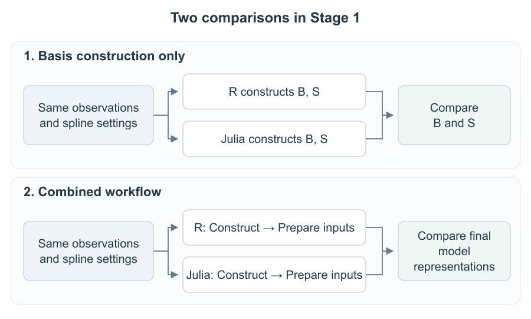

# Penalized splines as mixed models in Julia

We are developing a Julia approach to fitting smooth curves, with future integration into Unfold for EEG analysis. R's **mgcv** provides a reference for checking our work.

## How Stage 1 was checked

We check basis construction first, then the complete preparation of the mixed-model inputs:

1. **Basis construction only:** R and Julia independently construct `B,S` from the same observations and spline settings. No conversion runs in this check.
2. **Combined workflow:** R and Julia independently construct their spline and prepare `X_fixed,Z` from the same raw inputs. We compare the final model representations. The required fixed/random preparation runs inside this workflow; it is not a separate stage.

The documented comparisons passed. [DATA.md](DATA.md) explains the observations and test cases; [DERIVATION.md](DERIVATION.md) explains the construction and input-preparation mathematics; [VALIDATION.md](VALIDATION.md) explains how correctness is checked; [STAGE1_RESULTS.md](STAGE1_RESULTS.md) records the numerical results and links to detailed checks.

## Comparison flow

**Stage 1 covers this preparation.** Stage 2 will estimate coefficients and smoothing strength. Stage 3 will predict responses for new data.

## Model and inputs

A spline combines simple curve shapes to describe a nonlinear relationship. A penalty controls how much the curve bends. Representing the penalized components as random effects allows a linear mixed model to estimate smoothing through their variance. This connection is described in [mgcv's documentation](https://stat.ethz.ch/R-manual/R-devel/library/mgcv/html/gamm.html).

Our current model uses cubic B-splines with a curvature penalty. The main example has 200 simulated observations, eight raw basis functions and 12 full knot entries. A mean-zero constraint separates the spline from the intercept, leaving seven basis columns.

The prepared model contains:

| Input | Meaning | Main dimensions |
| --- | --- | --- |
| `y` | Observed responses to fit | 200 values |
| `B`, `S` | Curve shapes and their matching penalty | 200 × 7; 7 × 7 |
| `X_fixed` | Intercept and unpenalized spline component | 200 × 2 |
| `Z` | Penalized spline components sharing one random-effect variance | 200 × 6 |

Training knots and transformations are retained for later prediction. The linked evidence tables, captured R inputs and main Julia model inputs are included in the repository.

## Connection to the R fitting inputs

The [referenced `gamm.r` call](https://github.com/cran/mgcv/blob/1b6a4c8374612da27e36420b4459e93acb183f2d/R/gamm.r#L1398) passes the converted representation to `lme`, a linear mixed-effects model fitter:

| R argument | Meaning in our project |
| --- | --- |
| `fixed.formula` | Describes the response and components represented by `X_fixed` |
| `rand` | Describes the `Z` components, grouping and shared variance |
| `data` | Contains the observations and numerical matrices |
| `correlation` | Residual relationships; our example assumes independent errors |
| `weights` | Residual variability; our example assumes equal variability |
| `method` | Fitting method; the R reference uses REML |
| `control` | Numerical stopping rules and limits |

Understanding these inputs identifies the model that a Julia fitter must receive. The [captured R inputs](spline_workflow/outputs/shared/r_reference/lme_inputs/INPUTS_EXPLAINED.txt) provide a concrete example; the [official `lme` documentation](https://stat.ethz.ch/R-manual/R-devel/library/nlme/html/lme.html) explains the arguments.

## Next steps

- **Stage 2 — fitting:** first validate coefficient estimation with fixed smoothing strength, then variance-based smoothing estimation against R. Finally compare the complete fitting workflows.
- **Stage 3 — prediction:** apply the fitted model to new predictor values while retaining the training knots and transformations, and compare predictions with R.
- **Unfold integration:** use Unfold or UnfoldMixedModels where the required variance structure is supported with comparable efficiency. Validate on controlled examples before EEG applications. The final Julia workflow should run without R.
