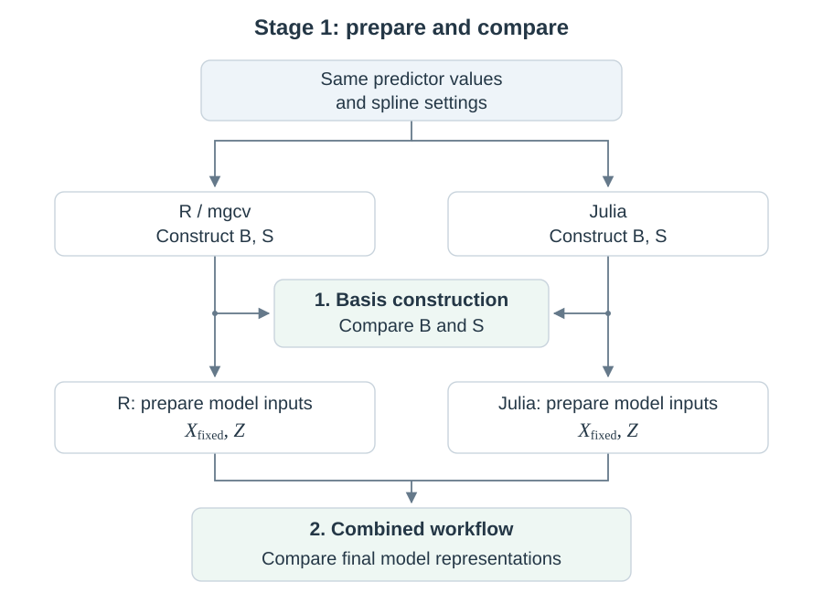
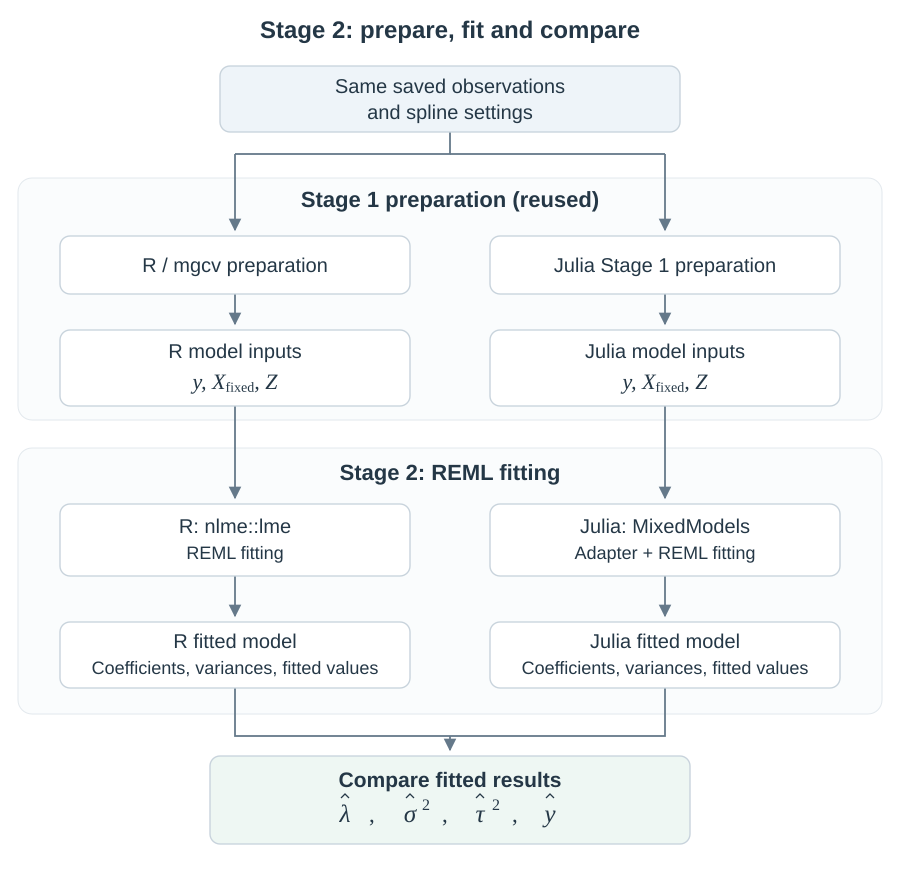

# Penalized splines as mixed models in Julia

We construct cubic B-splines in Julia, prepare their mixed-model inputs, and estimate smoothing with **MixedModels.jl**. R's **mgcv** and **nlme** provide the validation reference. Future work will connect this approach to Unfold for EEG analysis.

The project follows **model preparation → fitting → prediction**. Stages 1 and 2 are implemented and checked against R; Stage 3 is planned.

[DATA.md](DATA.md) explains the observations and test cases; [DERIVATION.md](DERIVATION.md) explains the mathematics; [VALIDATION.md](VALIDATION.md) defines the comparison criteria. [STAGE1_RESULTS.md](STAGE1_RESULTS.md) records input-preparation checks, and [STAGE2_RESULTS.md](STAGE2_RESULTS.md) records fitting results.

The main dimensions below refer to our **200-observation example with $k=8$ raw basis functions**. Matrix dimensions are written as rows × columns; other test cases use different basis sizes.

## Stage 1: prepare the model inputs

**Starts with:** 200 training predictor values $x$ and the spline settings: cubic B-splines (degree 3), $k=8$, a full vector of 12 knots, and an integrated squared-second-derivative penalty that controls curve bending. Knots can be supplied or calculated from the training predictor range.

Julia constructs the basis in [spline_basis](spline_basis) and prepares the fixed/random model matrices in [model_preparation](model_preparation). R's mgcv provides an independent reference for the same steps.

**Produces:** $X_{\mathrm{fixed}},Z$ for fitting, with training knots and transformations retained for prediction. The table also shows $B,S$, constructed along the way:

| Quantity | What it represents | Main dimensions |
| --- | --- | --- |
| $B$ | Centered spline basis | 200 × 7 |
| $S$ | Matching curvature penalty | 7 × 7 |
| $X_{\mathrm{fixed}}$ | Intercept and unpenalized spline component | 200 × 2 |
| $Z$ | Penalized spline components | 200 × 6 |

Centering separates the spline from the intercept, reducing eight raw basis columns to seven. $X_{\mathrm{fixed}}=[X,X_0]$ combines the ordinary intercept with the unpenalized spline component.

We check preparation independently of fitting:

1. **Basis construction only:** R and Julia independently construct $B,S$ from the same predictor values and spline settings. We compare them before fixed/random preparation.
2. **Combined workflow:** each language constructs its spline and prepares $X_{\mathrm{fixed}},Z$ from the same raw inputs. We compare the final model representations.

### Comparison flow



## Stage 2: fit and estimate smoothing

**Starts with:** the 200 observed responses $y$ and the Stage 1 matrices $X_{\mathrm{fixed}},Z$. The Stage 2 test repeats preparation in each branch from the same saved data and settings, then fits the model with REML.

R's `mgcv::gamm` prepares the spline and calls `nlme::lme`. Julia packages its own matrices in `FeTerm` and `ReMat` containers for `MixedModels.LinearMixedModel`, then calls `fit!`.

**Produces:** a fitted model containing the coefficients, variance estimates, smoothing strength and fitted responses below:

| Quantity | What it represents | Main dimensions |
| --- | --- | --- |
| $b$ | Fitted fixed coefficients | 2 values |
| $\tau$ | Fitted penalized spline coefficients | 6 values |
| $\sigma^2,r^2$ | Noise variance and shared spline variance | One value each |
| $\lambda$ | Smoothing strength derived from the variances | One value |
| $\hat y$ | Fitted responses at the training predictor values | 200 values |

REML estimates variances while accounting for fitted fixed effects. All six penalized coefficients share one Gaussian variance $r^2$; noise is independent Gaussian with variance $\sigma^2$, and observations have equal weights.

Using fitted coefficients and variances:

```math
\hat y=X_{\mathrm{fixed}}b+Z\tau,
\qquad
\lambda=\frac{\sigma^2}{r^2}.
```

Parameter symbols follow the derivation; here they denote fitted estimates. The hat on $\hat y$ distinguishes fitted responses from observed $y$. A larger $\lambda$ means stronger smoothing; it is derived from the variance fit, without an additional fitting step.

### Comparison flow



The two main comparisons are **smoothing strength $\lambda$** and **fitted responses $\hat y$** across five cases. Variance estimates remain supporting checks. Equivalent representations can have different coefficient coordinates, so raw coefficient entries are not the cross-language comparison. The [results](STAGE2_RESULTS.md) include a summary table, an overlaid curve plot and links to detailed estimates.

## Stage 3: predict at new predictor values — planned

**Starts with:** $m$ new predictor values $x_{\mathrm{new}}$, the fitted coefficients $b,\tau$ from Stage 2, and the training knots and transformations from Stage 1.

**Produces:** predicted responses, obtained by evaluating the fixed and penalized components at the new predictor values:

| Quantity | What it represents | Main dimensions |
| --- | --- | --- |
| $X_{\mathrm{fixed,new}}$ | Fixed components evaluated at new predictor values | $m$ × 2 |
| $Z_{\mathrm{new}}$ | Penalized components evaluated at new predictor values | $m$ × 6 |
| $\hat y_{\mathrm{new}}$ | Predicted responses | $m$ values |

The learned smoothing is already reflected in the fitted coefficients. We will compare Julia and R predictions at the same new predictor values. Observed responses at those points are not required to produce predictions.

After this, we plan to integrate with Unfold or UnfoldMixedModels where the required variance structure is supported with comparable efficiency, starting with controlled examples before EEG applications.

## Sources and package interfaces

Sources: [mgcv fitting](https://stat.ethz.ch/R-manual/R-devel/library/mgcv/html/gamm.html), [MixedModels constructors](https://juliastats.org/MixedModels.jl/stable/constructors/), and [MixedModels estimation](https://juliastats.org/MixedModels.jl/stable/optimization/). The [original R fitting call](https://github.com/cran/mgcv/blob/1b6a4c8374612da27e36420b4459e93acb183f2d/R/gamm.r#L1398) and [captured R inputs](model_preparation/outputs/shared/r_reference/lme_inputs/INPUTS_EXPLAINED.txt) document how R packages the same fixed/random model. The Julia fitting environment pins MixedModels 5.9.0 because the adapter uses its low-level container API.
