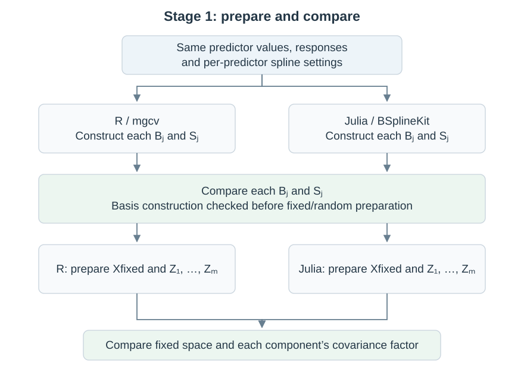
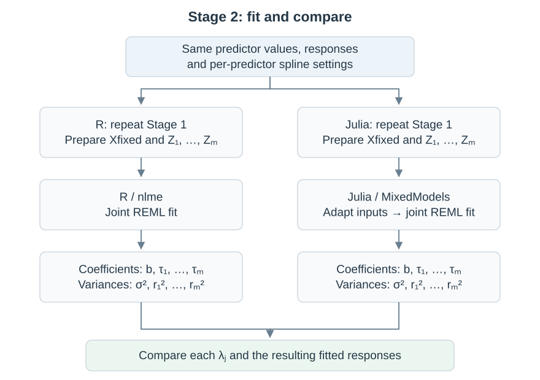

# Additive penalized splines as mixed models in Julia

We construct cubic B-splines with **BSplineKit.jl**, prepare their mixed-model representation, and estimate smoothing with **MixedModels.jl**. R's **mgcv** and **nlme** provide an independent reference. The workflow accepts a variable-length list of predictors; the current example uses two:

```math
y=f_1(x_1)+f_2(x_2)+\varepsilon,
\qquad f_1(x_1)=\sin(1.7x_1)+0.15x_1,
\qquad f_2(x_2)=0.5\cos(1.2x_2).
```

Each predictor has its own spline and smoothing strength. Their contributions add to one response; this example has no interaction term. Future work will connect this approach to Unfold for EEG analysis.

[DATA.md](DATA.md) explains the observations and five test cases; [DERIVATION.md](DERIVATION.md) connects the mathematics to model preparation; [VALIDATION.md](VALIDATION.md) defines the comparisons. Numerical evidence is in [STAGE1_RESULTS.md](STAGE1_RESULTS.md) and [STAGE2_RESULTS.md](STAGE2_RESULTS.md). [Fitting matrices](assets/FITTING_MATRICES.md) shows the actual arrays as heatmaps.

## Stage 1: prepare the model inputs

For each predictor, Julia constructs the basis and curvature penalty in [spline_basis](spline_basis), then prepares its fixed and penalized columns in [model_preparation](model_preparation). The same steps are repeated independently in R. The spline settings include basis size, knots and the second-derivative penalty.

BSplineKit evaluates the basis functions and derivatives and integrates their curvature products. Our wrapper retains mgcv's knot, scaling, centering and extrapolation conventions. BSplineKit is also used by [Unfold's spline extension](https://unfoldtoolbox.github.io/Unfold.jl/stable/references/extensions/).

For the main example, there are **200 observations and eight raw basis functions per predictor**:

| Prepared quantity | Meaning | Dimensions |
| --- | --- | --- |
| $B_j,S_j$ | Centered basis and matching penalty for predictor $j$ | 200 × 7; 7 × 7 each |
| $X_{\mathrm{fixed}}=[X,X_{0,1},X_{0,2}]$ | Ordinary fixed part and both unpenalized spline parts | 200 × 3 |
| $Z_1,Z_2$ | Penalized spline parts, kept in separate blocks | 200 × 6 each |

Here $X$ is a column of ones. Centering separates each spline's average level from the overall intercept. The required fixed/random preparation remains inside this workflow.

We use two comparisons: **basis construction** compares independently built $B_j,S_j$ before preparation; the **complete preparation** compares the final fixed-effect space and each random-effect covariance factor.



The number of predictors is determined by the saved term list, rather than hard-coded in the preparation or fitting functions. `prepare_additive` assembles the fixed matrix and a variable-length list of penalized matrices. Each term can have a different basis size.

The caller supplies the ordinary fixed matrix $X$ explicitly; this example uses a column of ones. Prediction receives the new fixed columns explicitly, and both languages read the same saved prediction grid.

## Stage 2: jointly fit the splines

Both branches repeat preparation from the same saved data, then fit the noisy response $y$ with **REML**. R uses `mgcv::gamm` / `nlme::lme`; Julia calls the low-level `MixedModels.LinearMixedModel` constructor and `fit!` with its own prepared designs.

```math
y=X_{\mathrm{fixed}}b+\sum_{j=1}^{m}Z_j\tau_j+\varepsilon,
\qquad \tau_j\sim N(0,r_j^2I),
\qquad \varepsilon\sim N(0,\sigma^2I).
```

The spline coefficient vectors are independent of each other and of the noise. The main example produces three fixed coefficients $b$, two penalized coefficient vectors $\tau_j$ of length six, two spline variances $r_j^2$, and one noise variance $\sigma^2$. Each smoothing strength is derived from the same fit:

```math
\lambda_j=\frac{\sigma^2}{r_j^2},
\qquad
\hat y=X_{\mathrm{fixed}}b+\sum_j Z_j\tau_j.
```



**Fitting inputs:** Julia passes the prepared $y$, $X_{\mathrm{fixed}}$ and separate $Z_j$ blocks directly to MixedModels, keeping their original observation rows and coefficient coordinates. Each block uses native `ReMat` storage with its diagonal variances tied to one shared parameter by [SharedVariance.jl](spline_fitting/src/SharedVariance.jl). The code uses the pinned MixedModels 5.9.0 low-level API. Fitted responses already correspond to the original observations.

R performs internal QR transformations in [nlme's fitting code](https://github.com/cran/nlme/blob/3.1-169/src/matrix.c#L195-L223). Each package handles its own numerical factorization; we compare the covariance model and fitted results.

**Why no extra rotation?** Direct fitting and QR-only preprocessing gave practically identical results and both agreed with R across five 200-observation cases. In 30 paired repetitions per case, QR had 1–19% higher median runtime and allocated 18–24% more bytes. We therefore keep direct fitting for these cases. See the [benchmark summary](spline_fitting/outputs/shared/comparison/qr_benchmark_summary.tsv), [agreement checks](spline_fitting/outputs/shared/comparison/qr_benchmark_agreement.tsv), [individual runs](spline_fitting/outputs/shared/comparison/qr_benchmark_runs.tsv), and [measurement settings](spline_fitting/outputs/shared/comparison/qr_benchmark_settings.tsv).

We compare **each $\lambda_j$**, the combined fitted responses, individual spline contributions and shared-grid predictions. Variances provide supporting checks. Coefficients are returned in Julia's original spline coordinates; their raw entries are not compared across different R/Julia coordinate choices. The results show a 3D response surface for the two-predictor example, plus separate component curves.

## Stage 3: prediction and later integration

Prediction evaluates each spline at new predictor values using its **training knots and transformations**, then combines the saved coefficients. The new rows must contain a value for every fitted predictor; responses are not required.

**Prediction error:** on 961 new grid points, the two-predictor example has RMSE **0.0794 for R and Julia** against the known noiseless surface, in response units. [Prediction results](spline_fitting/outputs/shared/comparison/truth_comparison.tsv).

**Variable component counts:** the fitting tests were rerun with 160 synthetic observations for each count; **105/105 checks passed**. The table shows measured differences from an independent Gaussian matrix calculation using the same fitted variance values.

| Spline components | Largest coefficient relative error | Fitted-response relative error |
| ---: | ---: | ---: |
| 1 | 9.69e-15 | 7.90e-15 |
| 2 | 9.40e-15 | 6.49e-15 |
| 3 | 1.25e-14 | 8.40e-15 |
| 10 | 1.36e-14 | 4.13e-15 |

Relative error is the norm of the difference divided by the larger result norm. The coefficient column reports the largest error across $b$ and the $\tau_j$ vectors. These values measure numerical agreement; the RMSE above measures recovery of the known surface. [Full measured errors](spline_fitting/outputs/shared/unit_tests.txt); [test calculations](spline_fitting/test/runtests.jl).

The interface accepts a variable number of spline components, subject to rank and sample-size requirements. Broader prediction studies and integration with Unfold or UnfoldMixedModels remain future work.

Sources: [BSplineKit](https://jipolanco.github.io/BSplineKit.jl/stable/), [mgcv fitting](https://stat.ethz.ch/R-manual/R-devel/library/mgcv/html/gamm.html), [smooth-to-random preparation](https://stat.ethz.ch/R-manual/R-devel/library/mgcv/html/smooth2random.html), [MixedModels constructors](https://juliastats.org/MixedModels.jl/stable/constructors/), and [MixedModels estimation](https://juliastats.org/MixedModels.jl/stable/optimization/). The [original R call](https://github.com/cran/mgcv/blob/1b6a4c8374612da27e36420b4459e93acb183f2d/R/gamm.r#L1398) is connected to the [captured R inputs](model_preparation/outputs/shared/r_reference/lme_inputs/INPUTS_EXPLAINED.txt).
