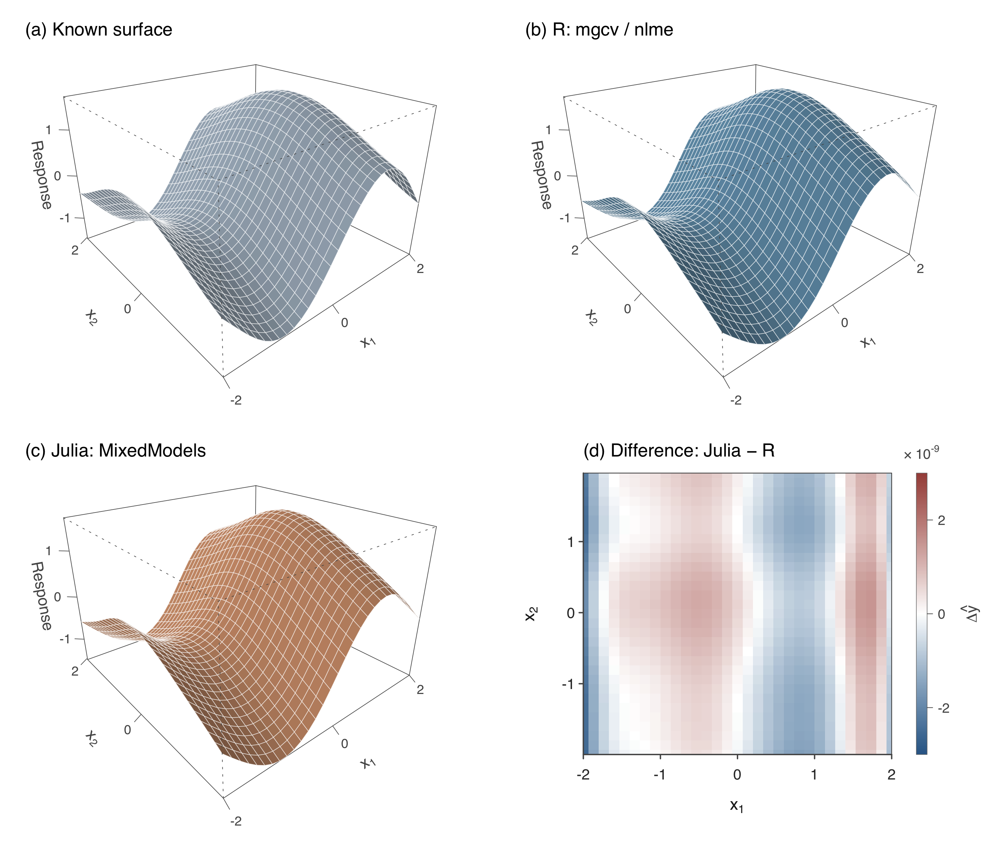
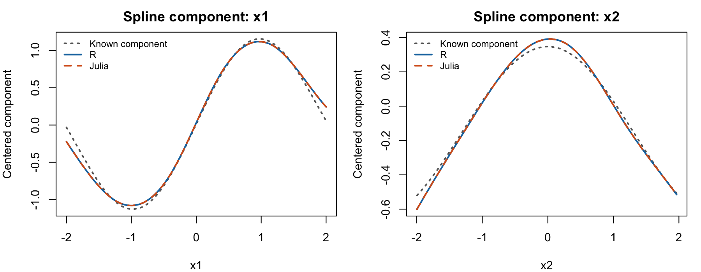

# Stage 2 results

R and Julia independently prepare and fit the same additive model. R uses `mgcv::gamm` / `nlme::lme`; Julia uses `MixedModels.jl`. REML jointly estimates a separate spline variance for each predictor and one common noise variance.

**90/90 comparisons passed across 5 cases.** Spline-component counts: 2.

## Smoothing estimates

Each component has its own $\lambda_j=\sigma^2/r_j^2$. The table compares these smoothing strengths; the variance values and their errors are retained in the detailed estimates.

| Case | Component | R $\lambda_j$ | Julia $\lambda_j$ | Relative error |
| --- | --- | ---: | ---: | ---: |
| `uniform_k8` | $x_1$ | 0.56176456 | 0.56176461 | 9.21e-08 |
| `uniform_k8` | $x_2$ | 5.4194393 | 5.4194392 | 1.80e-08 |
| `default_k8` | $x_1$ | 0.56176456 | 0.56176461 | 9.22e-08 |
| `default_k8` | $x_2$ | 5.4194393 | 5.4194392 | 1.81e-08 |
| `uneven_k10` | $x_1$ | 4.1679192 | 4.167919 | 3.98e-08 |
| `uneven_k10` | $x_2$ | 0.83912958 | 0.83912974 | 1.91e-07 |
| `duplicates_k6` | $x_1$ | 0.079999323 | 0.079999328 | 6.02e-08 |
| `duplicates_k6` | $x_2$ | 5.2855236 | 5.2855236 | 5.04e-09 |
| `small_k5` | $x_1$ | 0.0085183673 | 0.008518378 | 1.26e-06 |
| `small_k5` | $x_2$ | 0.20653478 | 0.2065351 | 1.53e-06 |

Largest scaled difference in training fitted responses: **1.70e-08**; on the shared evaluation grid: **1.93e-08**.

## Joint response and individual components

Panels (a–c) share the same viewing angle and response limits. Panel (d) shows Julia minus R with a symmetric colour scale centred at zero; the multiplier above its colourbar gives the scale. Its maximum absolute difference is **2.59e-09**. The known surface is a simulation reference; only the noisy observations are used for fitting.

Each panel isolates one spline contribution. Known components are centered over the training observations to match the fitted smooths; their removed average levels belong to the overall intercept.

## Supporting checks

[Individual comparisons](spline_fitting/outputs/shared/comparison/checks.tsv) and [detailed estimates](spline_fitting/outputs/shared/comparison/estimates.tsv) record all cases. The acceptance criteria are defined in [VALIDATION.md](VALIDATION.md).

[Julia unit tests](spline_fitting/outputs/shared/unit_tests.txt) independently check covariance, the REML objective, coefficients and restoration of observation coordinates for 1, 2, 3 and 10 components, including unequal block sizes and the zero-variance boundary.

[R fitting status](spline_fitting/outputs/shared/r_reference/fit_summary.tsv); [Julia fitting status](spline_fitting/outputs/shared/julia/fit_summary.tsv); [source fingerprints](spline_fitting/outputs/shared/r_reference/source_checksums.tsv).

Both languages use the same saved observations, per-predictor settings and evaluation grid. Package versions are recorded in each branch's `versions.tsv`; Julia dependencies are pinned by the root `Manifest.toml`.
