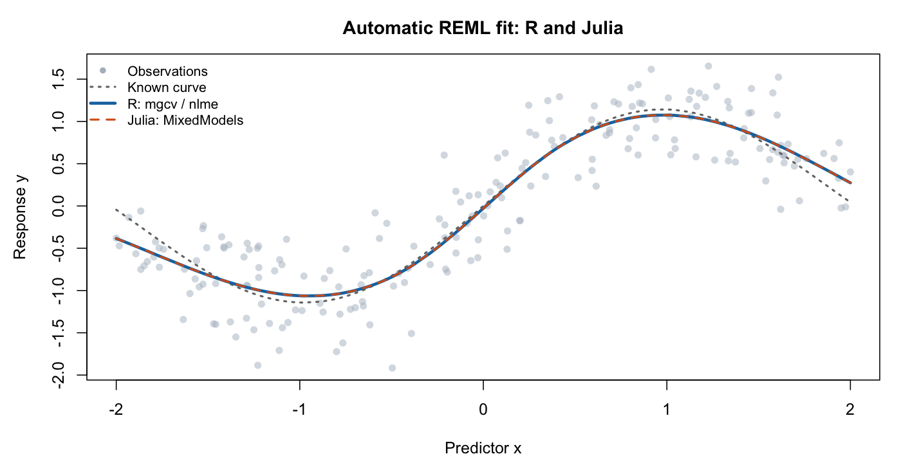

# Stage 2 results

Both branches repeat Stage 1 preparation from the same saved data, then fit with **REML**. R uses `mgcv::gamm` with `nlme::lme`; Julia uses prepared `FeTerm` and `ReMat` inputs with `MixedModels.LinearMixedModel`.

**50/50 reference comparisons passed across five cases.** No smoothing parameter is fixed before fitting.

## Estimated smoothing and fitted curves

Each fit estimates $\sigma^2$ and $r^2$; $\lambda=\sigma^2/r^2$ is derived from the same fit. Parameter symbols follow the derivation and denote fitted estimates here.

The table compares smoothing strength $\lambda$ and all 200 fitted responses, $\hat y_R$ and $\hat y_{\mathrm{Julia}}$, in their original observation order. Matching $\lambda$ checks smoothing; matching $\hat y$ checks the resulting curve. Acceptance thresholds are $10^{-5}$ for the relative error in $\lambda$ and $10^{-6}$ for the scaled fitted-response error, as defined in VALIDATION.md.

| Case | R $\lambda$ | Julia $\lambda$ | $\lambda$ relative error | Fitted-response scaled error |
| --- | ---: | ---: | ---: | ---: |
| `uniform_k8` | 0.60963055 | 0.609630639 | 1.45e-07 | 1.50e-09 |
| `default_k8` | 0.609630551 | 0.609630639 | 1.44e-07 | 1.50e-09 |
| `uneven_k10` | 4.42327209 | 4.42327175 | 7.49e-08 | 9.50e-10 |
| `duplicates_k6` | 0.0534448003 | 0.0534448028 | 4.61e-08 | 2.28e-10 |
| `small_k5` | 0.00962105738 | 0.00962105456 | 2.94e-07 | 2.06e-09 |

Gray points are the observed $y$ values supplied to both fitters; the dotted curve is the known simulation curve. The blue R and orange Julia curves show their fitted responses $\hat y$ and nearly coincide.

## Supporting checks

The [detailed estimates](spline_fitting/outputs/shared/comparison/estimates.tsv) retain $\sigma^2$ and $r^2$ for every case. These check the variance scale, which is not determined by their ratio alone.
Their largest relative error is **2.89e-07**, below the $10^{-5}$ threshold.

Independent Julia tests check that the input adapter preserves the covariance model, REML objective and fitted coefficients. They also check invariance to rotated spline directions, the zero-variance boundary and invalid inputs.

[Detailed comparisons](spline_fitting/outputs/shared/comparison/checks.tsv); [Julia test log](spline_fitting/outputs/shared/unit_tests.txt). [R fitting status](spline_fitting/outputs/shared/r_reference/fit_summary.tsv) and [Julia fitting status](spline_fitting/outputs/shared/julia/fit_summary.tsv) record the individual fits.

## Reproducibility

Versions: R version 4.6.1 (2026-06-24); mgcv 1.9.4; nlme 3.1.169; Julia 1.13.1; MixedModels 5.9.0; StatsModels 0.7.10.

The same saved observations and five knot settings are reused from Stage 1. [Input fingerprints](spline_fitting/outputs/shared/r_reference/source_checksums.tsv) confirm the R source files; both languages' saved predictor, response and knot values are compared directly. The Julia dependency versions are pinned in `spline_fitting/Manifest.toml`.
