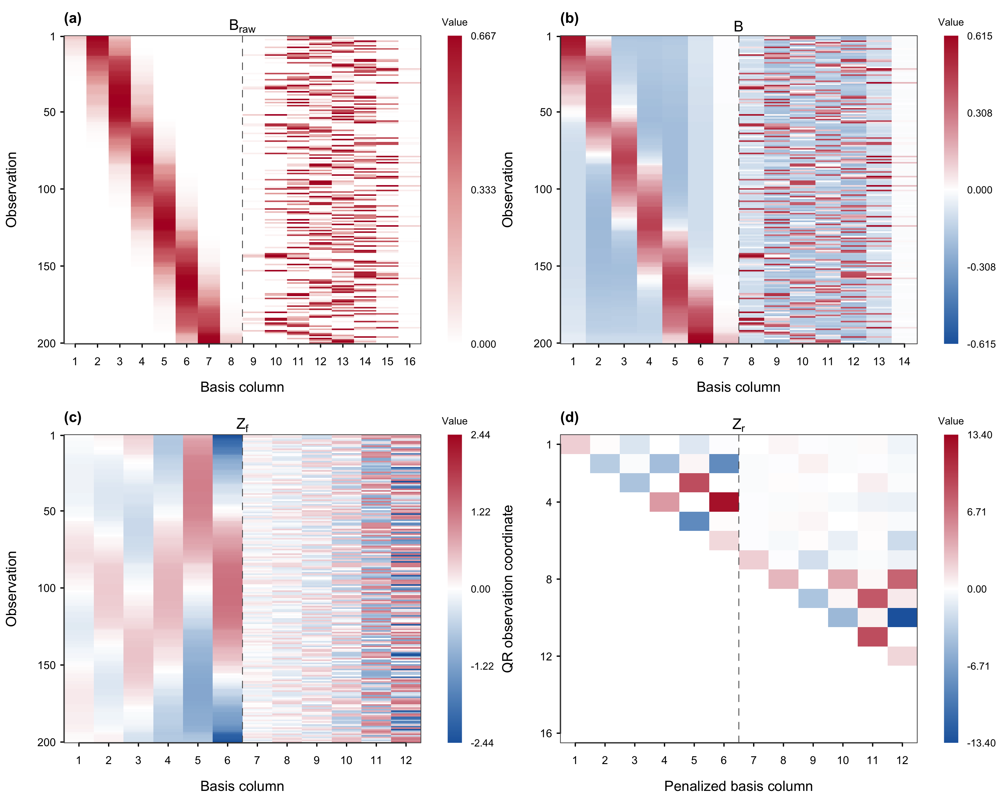
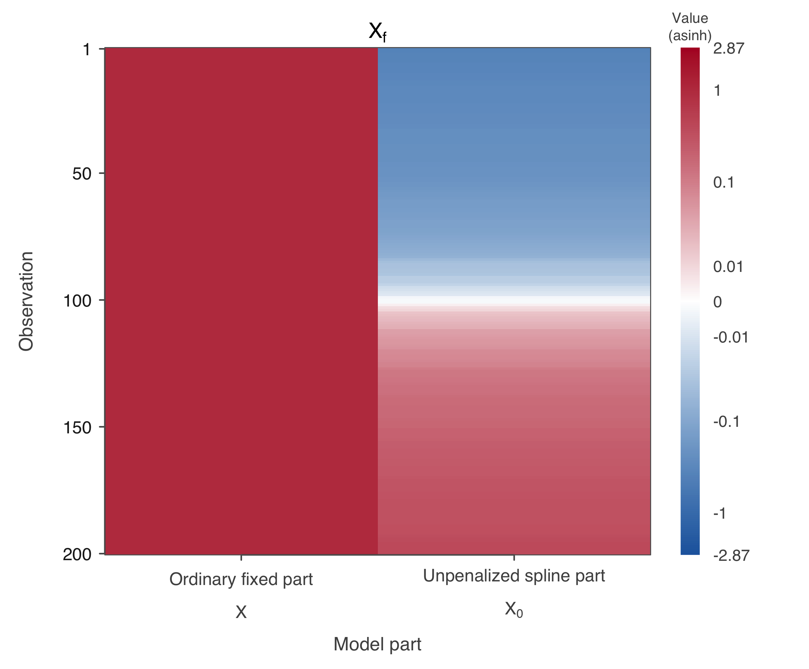
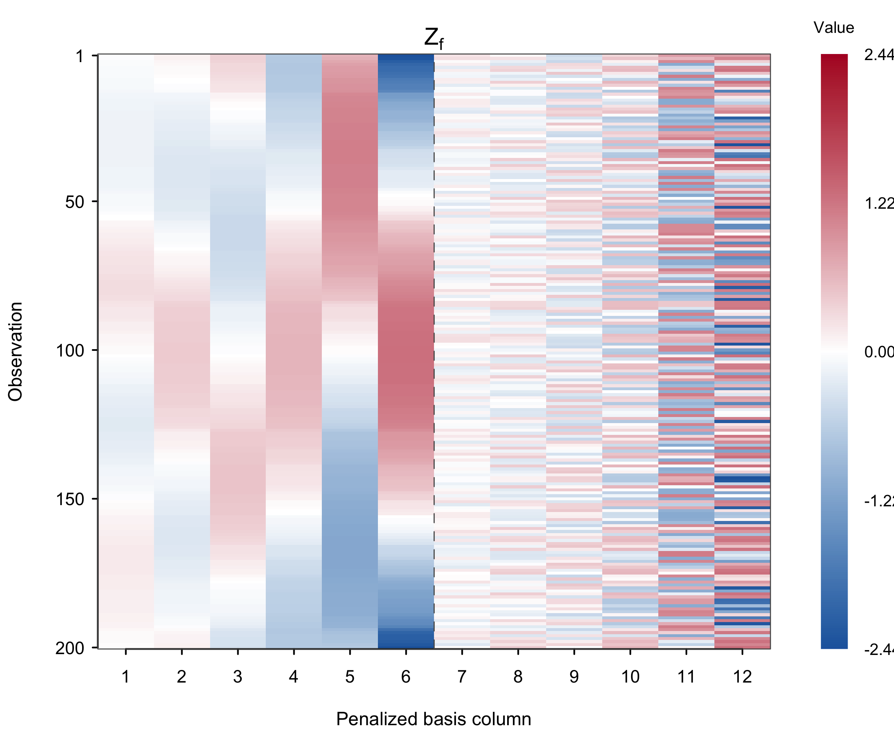

# Matrices used for additive spline fitting

The main example has 200 observations and two spline components, each with eight raw basis functions. Columns from $x_1$ come first, followed by those from $x_2$; dashed lines mark their boundary. These are the actual saved Julia matrices.

- **(a) $B_{\mathrm{raw}}$ (200 × 16):** both raw bases side by side. Each entry is one basis function evaluated at that observation's predictor value.
- **(b) $B$ (200 × 14):** the centered bases, $B_j=B_{\mathrm{raw},j}H_j$. Each spline's average level is separated from the overall intercept.
- **(c) $Z_f=[Z_1,Z_2]$ (200 × 12):** penalized basis directions, rescaled using each penalty matrix. The two unpenalized directions are included in $X_f$.
- **(d) $X_f=[X,X_{0,1},X_{0,2}]$ (200 × 3):** the ordinary fixed part and both unpenalized spline parts. Here $X$ is a column of ones.

MixedModels receives $y$, $X_f$ and the separate $Z_j$ blocks directly. All 200 observation rows and the prepared coefficient coordinates are retained; no QR/SVD input rotation is applied.

Colour represents entry values: red is positive, blue is negative, and white is zero or near zero. Each panel has its own linear scale. Rows are ordered by $x_1$; $x_2$ remains independently ordered, explaining its less gradual colour pattern.

## Xf: fixed model parts

$b$ contains one coefficient for each column. The product $X_fb$ gives the combined fixed contribution at the original observations.

## Zf: penalized spline parts

Each six-column block is $Z_j=B_jU_{+,j}D_{+,j}^{-1/2}$. Its columns describe penalized shapes for that predictor. The two blocks remain separate in the model, so each can have its own smoothing strength.

**Sources:** [shared observations and settings](../data/inputs/uniform_k8/), [BSplineKit construction](../spline_basis/src/BSpline.jl), [component preparation](../model_preparation/src/ModelInputs.jl), [direct fitting](../spline_fitting/src/SplineFit.jl), [shared variance storage](../spline_fitting/src/SharedVariance.jl), and the [plot generator](plot_matrices.R). The [derivation](../DERIVATION.md) explains the transformations.
