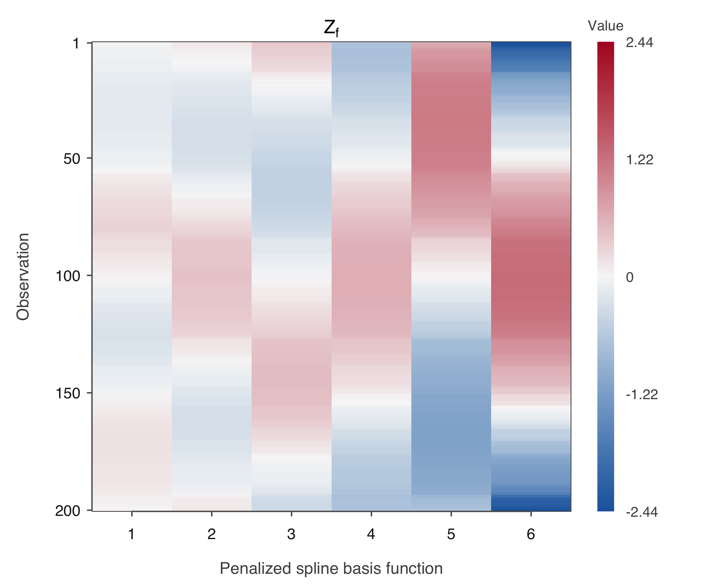
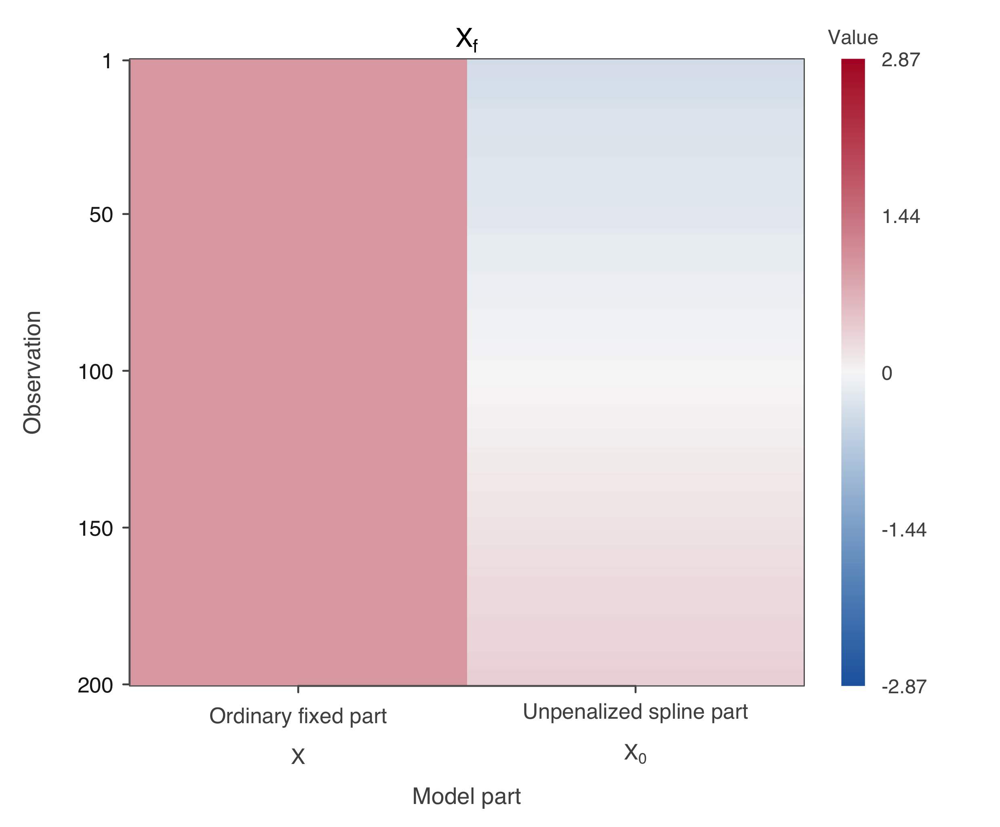
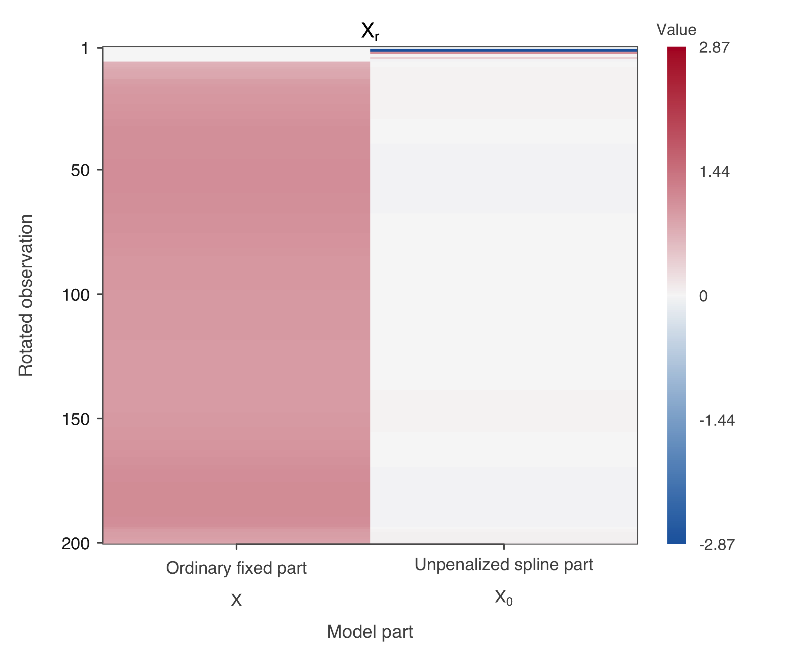
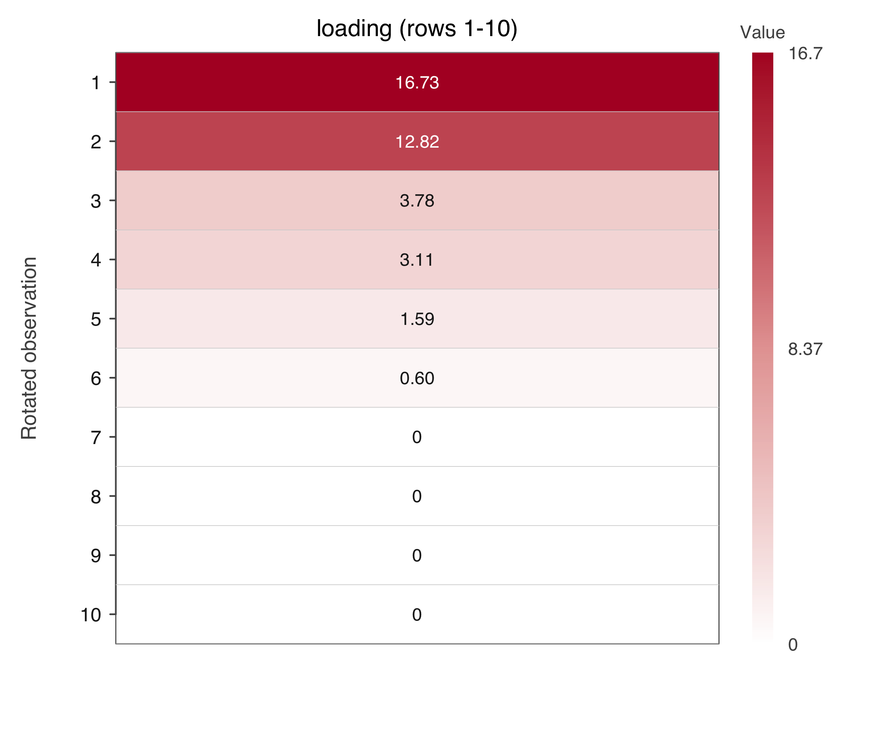

# Matrices used for spline fitting

These plots use Julia's `uniform_k8` example: 200 observations and a raw spline basis of size `k = 8`. After centering, the spline has six penalized directions and one unpenalized straight trend. The plotted entries are computed before REML fitting.

Colour represents the numerical entry value: red is positive, blue is negative, and white is zero or near zero. `Xf` and `Xr` share the same colour limits.

## Zf: penalized spline part

`Zf` is the prepared matrix $Z$, with 200 rows and six columns. Each column contains one penalized basis function's values at the observations. It is obtained from the centered basis $B$ using the positive-eigenvalue directions of the penalty matrix $S$, with rescaling. The smooth colour bands reflect basis functions evaluated at ordered predictor values.

## Xf: fixed model parts before rotation

`Xf` combines the ordinary fixed part $X$ and the unpenalized spline part $X_0$, giving 200 rows and two columns. In this example, $X$ is a column of ones, so its colour is uniform. $X_0$ is a centered straight trend, so its values change gradually across observations.

## Xr: the same fixed parts after rotation

The fitting adapter derives an orthogonal row transformation $T$ from QR and SVD calculations on `Zf`, then computes $X_r = T X_f$. The columns retain their model roles, while each new row combines original observation rows. This changes the colour pattern.

The response and random-effect design are transformed consistently to preserve the model. The response is rotated independently of the fixed-effect columns; placing them side by side with `hcat` does not mix them.

## loading: values used to package the random-effect design

The local `loading` vector contains the six singular values of `Zf`, followed by 194 zeros. Its nonzero values form the diagonal of the transformed random-effect design. The figure shows the first ten rows; all later entries are zero. All 200 observations remain in the fit.

These are singular values of the design matrix `Zf`, distinct from the eigenvalues of the penalty matrix $S$.

**Sources:** [shared observations and knots](../data/inputs/uniform_k8/), [BSplineKit-based construction](../spline_basis/src/BSpline.jl#L69), [spline input preparation](../model_preparation/src/ModelInputs.jl#L20), and [QR/SVD fitting adapter](../spline_fitting/src/SplineFit.jl#L28). The [derivation](../DERIVATION.md) explains the basis and penalty transformations.
