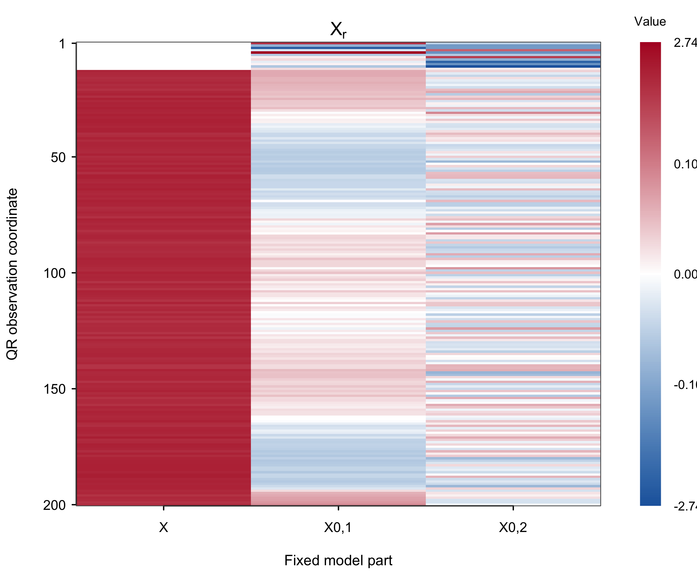
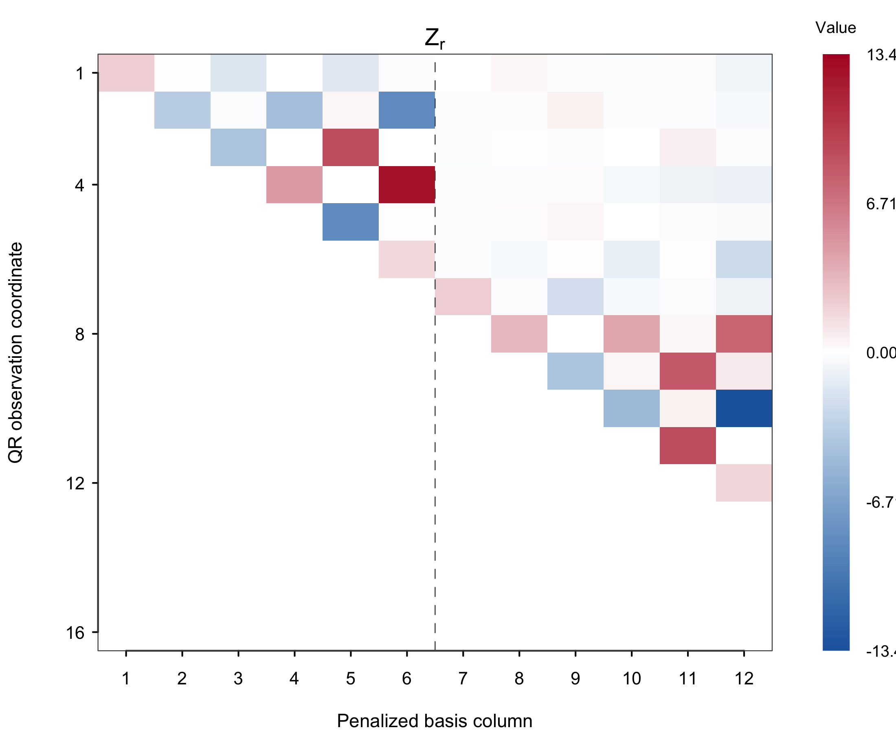
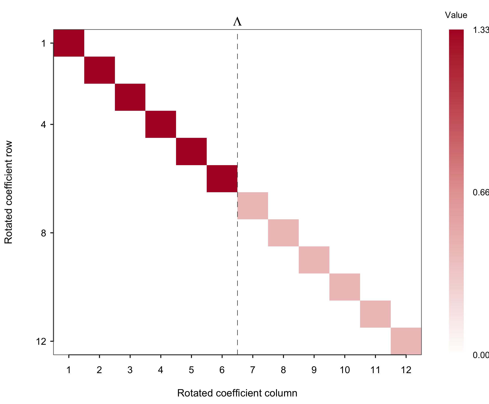

# Matrices used for additive spline fitting

The main example has 200 observations and two spline components, each with eight raw basis functions. Columns from $x_1$ come first, followed by those from $x_2$; dashed lines mark their boundary. These are the actual saved Julia matrices.

<a href="fitting_matrices.png"></a>

- **(a) $B_{\mathrm{raw}}$ (200 × 16):** both raw bases side by side. Each entry is one basis function evaluated at that observation's predictor value.
- **(b) $B$ (200 × 14):** the centered bases, $B_j=B_{\mathrm{raw},j}H_j$. Each spline's average level is separated from the overall intercept.
- **(c) $Z_f=[Z_1,Z_2]$ (200 × 12):** penalized basis directions, rescaled using each penalty matrix. The two unpenalized directions are included in $X_f$.
- **(d) $Z_r=[TZ_1V_1,TZ_2V_2]$ (200 × 12):** the adapted random-effect designs. Only rows 1–16 are shown; rows 13–200 are zero. All 200 observations remain in the model.

Colour represents entry values: red is positive, blue is negative, and white is zero or near zero. Each panel has its own linear scale. Rows are ordered by $x_1$; $x_2$ remains independently ordered, explaining its less gradual colour pattern.

## Xf: fixed model parts before rotation

<a href="xf_heatmap.png"></a>

$X_f=[X,X_{0,1},X_{0,2}]$ has 200 rows and three columns: the ordinary fixed part and one unpenalized spline trend for each predictor. Here $X$ is a column of ones. $X_f$ and $X_r$ share the same nonlinear colour scale, `asinh(value / 0.01)`, with labels showing original values.

## Xr: the same fixed parts after rotation

<a href="xr_heatmap.png"></a>

The adapter computes $X_r=TX_f$. Each new row is a weighted combination of original observation rows; columns keep their model roles. The same row transformation is applied to $y$ and every random-effect block. `hcat(y,Xf)` places columns side by side and transforms them independently.

## Zf: penalized spline parts before rotation

<a href="zf_heatmap.png"></a>

Each six-column block is $Z_j=B_jU_{+,j}D_{+,j}^{-1/2}$. Its columns describe penalized shapes for that predictor. The two blocks remain separate in the model, so each can have its own smoothing strength.

## Zr: penalized spline parts after rotation

<a href="zr_heatmap.png"></a>

A common row rotation $T$ and separate coefficient rotations $V_j$ produce $Z_{r,j}=TZ_jV_j$. With multiple spline components, the upper block is generally dense. Coefficient directions are rotated only within their own component, preserving its variance $r_j^2I$.

## loading: relative covariance factor after fitting

<a href="loading_heatmap.png"></a>

Here the loading plot shows the fitted relative covariance factor:

```math
\Lambda=\mathrm{blockdiag}(\theta_1I_6,\theta_2I_6),
\qquad\theta_j=r_j/\sigma.
```

Each diagonal block repeats one component's fitted scale; off-diagonal entries are zero. This replaces the old single-component row-loading illustration. Unlike the preceding design matrices, $\Lambda$ is obtained after REML fitting. It contains variance scales, not penalty eigenvalues or design singular values.

**Sources:** [shared observations and settings](../data/inputs/uniform_k8/), [BSplineKit construction](../spline_basis/src/BSpline.jl), [component preparation](../model_preparation/src/ModelInputs.jl), [input rotation and restoration](../spline_fitting/src/SplineFit.jl), [shared variance storage](../spline_fitting/src/SharedVariance.jl), and the [plot generator](plot_matrices.R). The [derivation](../DERIVATION.md) explains the transformations.
