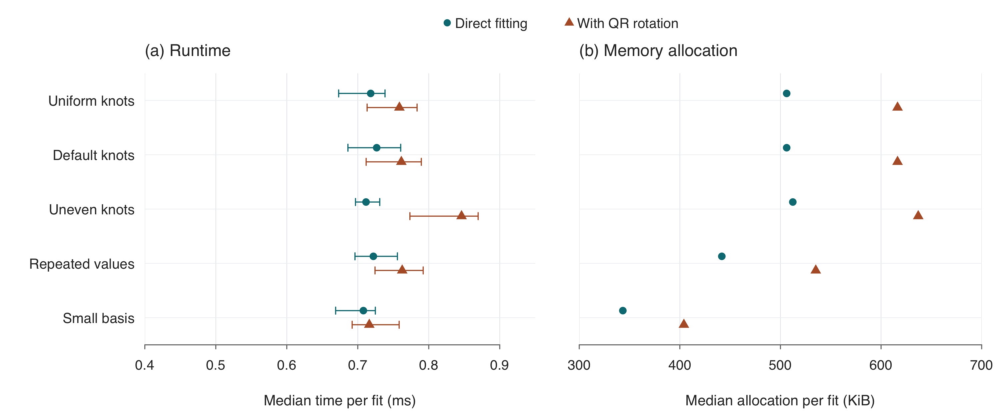
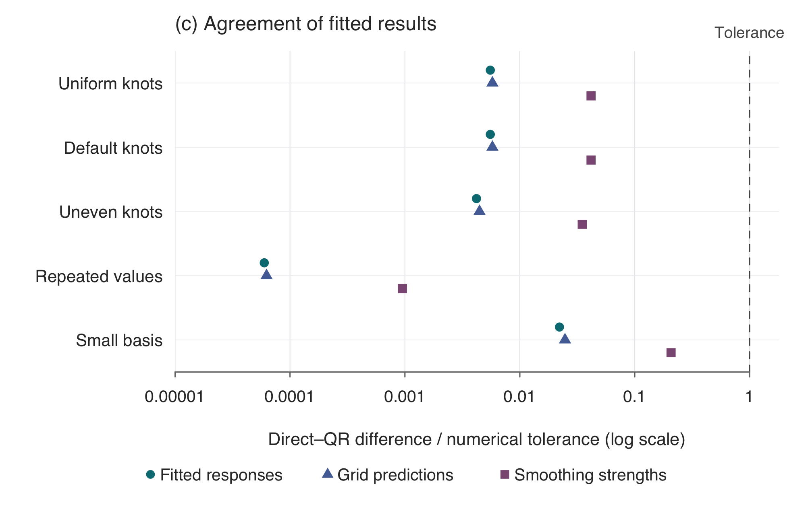

# Direct fitting versus extra QR rotation

We compared fitting the prepared matrices directly with applying QR rotation before fitting. Both used the same inputs, variance structure and REML settings. The five cases each have 200 observations and two predictors, with 30 repetitions per method and case.

- **(a) Runtime:** points show median time; lines cover the middle 50% of runs. QR had 1–19% higher median runtime, although several ranges overlap.
- **(b) Memory allocation:** points show median allocated memory per fit, in KiB (1 KiB = 1,024 bytes). QR allocated 18–24% more bytes. This is total allocation during a fit, rather than peak RAM usage.

Further left means faster fitting or fewer allocated bytes. The axes start at **0.4 ms** and **300 KiB** to reduce empty space. Timing includes model construction and fitting; the common spline-construction step is excluded.

## Agreement of fitted results

Each point shows the direct–QR difference divided by its existing [numerical tolerance](../VALIDATION.md): $10^{-6}$ for fitted responses and grid predictions, and $10^{-5}$ for smoothing strengths. Response differences use scaled vector errors; smoothing differences use relative errors. **Points below 1 pass the comparison.** Every point lies to the left of the dashed tolerance line across all five cases.

Both methods passed the R agreement checks and gave practically identical fitted results. The extra QR step provided no measured benefit in these cases, so we use direct fitting.

## Supporting data and measurement settings

[Summary](../spline_fitting/outputs/shared/comparison/qr_benchmark_summary.tsv), [individual runs](../spline_fitting/outputs/shared/comparison/qr_benchmark_runs.tsv), [agreement checks](../spline_fitting/outputs/shared/comparison/qr_benchmark_agreement.tsv), and [settings](../spline_fitting/outputs/shared/comparison/qr_benchmark_settings.tsv) are saved in this repository. Measurements used an Apple M3, Julia 1.13.1 and MixedModels 5.9.0, with one Julia thread and one BLAS thread. Both fitting paths were warmed before timing. The [plot generator](plot_qr_comparison.R) reads these saved results; no model is refitted to draw the figures.
